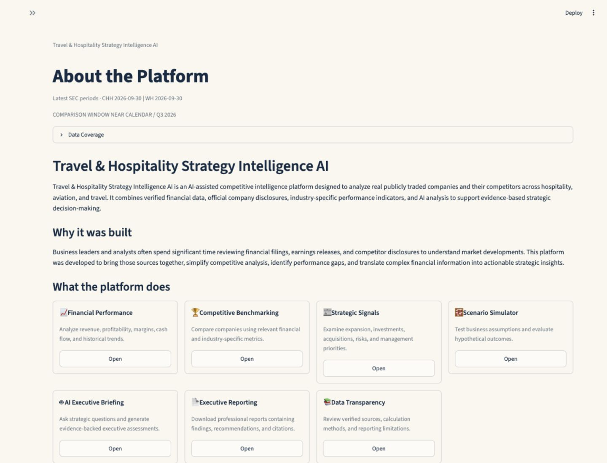
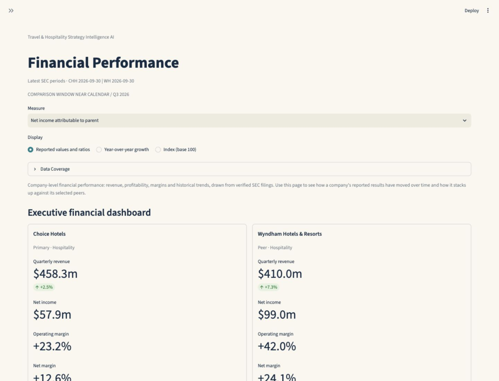
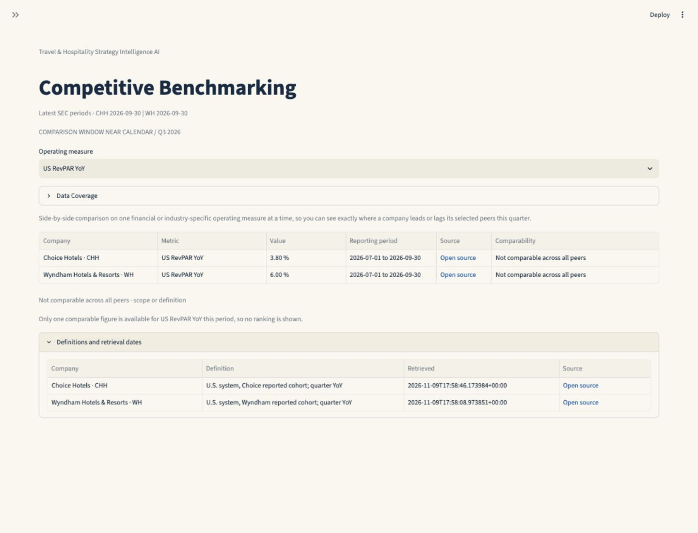
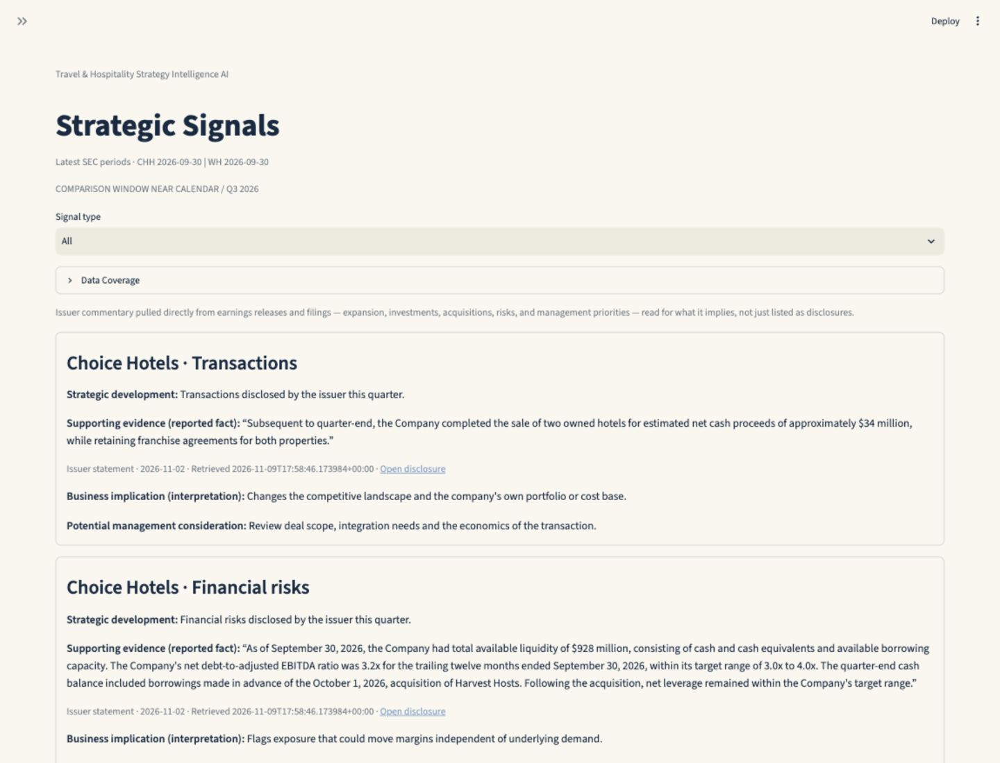
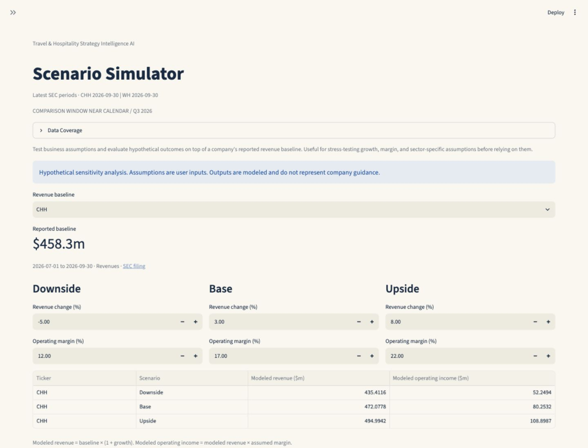
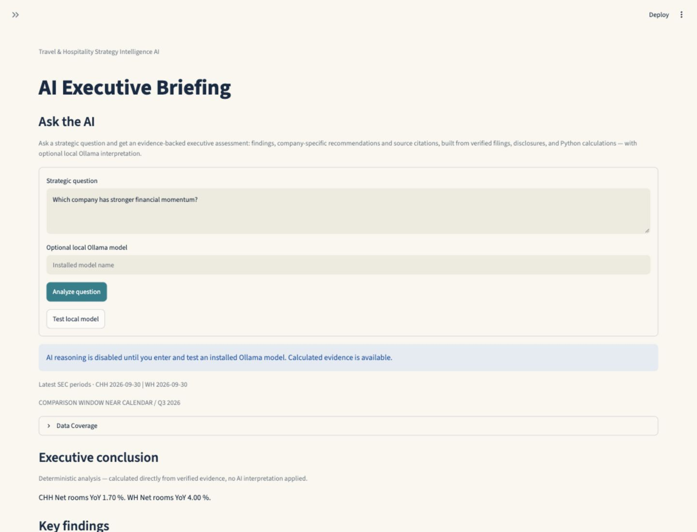

# Travel & Hospitality Strategy Intelligence AI

A Streamlit workspace for comparing publicly traded hotels, airlines, and travel companies using SEC filings and issuer disclosures. It brings financial trends, operating benchmarks, strategic developments, scenario analysis, and executive reporting into one workflow.

I built this project to shorten the path from a peer-comparison question to an executive brief that an analyst can defend. A hotel operator can investigate whether growth is coming with stronger margins, an airline analyst can compare capacity and demand indicators, and a travel strategy team can track developments that warrant a closer look. Each workflow keeps the underlying reporting periods and sources visible.

**Live demo:** Streamlit Community Cloud URL forthcoming.

## Dashboard gallery

Actual screenshots from the locally running app, using cached public disclosures for Choice Hotels (CHH) and Wyndham Hotels & Resorts (WH) for the quarter ended September 30, 2026.

| | |
| --- | --- |
| **About the Platform**<br>Project purpose and a guided entry into the workspace.<br> | **Financial Performance**<br>Quarterly revenue, net income, and margins for Choice and Wyndham.<br> |
| **Competitive Benchmarking**<br>U.S. revenue per available room (RevPAR) with the issuer definitions and the reason a ranking is withheld.<br> | **Strategic Signals**<br>Issuer statements on transactions and financial risks, alongside their business implications.<br> |
| **Scenario Simulator**<br>Downside, base, and upside assumptions applied to Choice Hotels’ reported revenue baseline.<br> | **AI Executive Briefing**<br>Calculated briefing with Ollama disabled. The interface labels the analysis accordingly.<br> |

## Contents

- [Application sections](#application-sections)
- [How the agent works](#how-the-agent-works)
- [Business use cases](#business-use-cases)
- [Data sources and limitations](#data-sources-and-limitations)
- [Technology stack](#technology-stack)
- [Run locally](#run-locally)
- [Streamlit Community Cloud](#streamlit-community-cloud)
- [Run the tests](#run-the-tests)

## Application sections

| Section | What an analyst can do |
| --- | --- |
| About the Platform | Understand the scope and open the relevant workspace. |
| Financial Performance | Review reported financials, margins, year-over-year changes, and historical trends for eligible peers. |
| Competitive Benchmarking | Compare a selected measure and inspect its definition, reporting window, and source. |
| Strategic Signals | Review issuer disclosures about transactions, expansion, risks, and management priorities, with interpretations labeled separately. |
| Scenario Simulator | Adjust revenue, margin, or available sector-specific assumptions and inspect the modeled effects. |
| AI Executive Briefing | Ask a strategic question, inspect calculated evidence, and export a PDF with findings, sources, and limitations. A tested local Ollama model can add interpretation. |
| Data Sources & Methodology | Inspect source links, coverage, reporting dates, and calculation rules. |

## How the agent works

**Collect → Validate → Compare → Interpret → Report**

1. **Collect.** Resolve company identifiers through the SEC directory and retrieve available structured facts, filings, and supported issuer disclosures. SQLite caches retrieved responses.
2. **Validate.** Check the reporting window, units, accounting concept, and operating definition. The coverage view distinguishes an unloaded source, failed refresh, unmatched period, and undisclosed metric. Missing observations stay separate from zero.
3. **Compare.** Python calculates margins, growth, and scenario outputs. The dashboard keeps actual reporting dates visible and limits charts and rankings to eligible observations.
4. **Interpret.** The app assembles relevant verified evidence and can send it to a tested local Ollama model. The model is instructed to use that evidence and its citation references and to avoid inventing financial results, sources, or explanations. The app checks the response before displaying it. If the model is unavailable or its response fails validation, the app labels and displays the deterministic analysis separately.
5. **Report.** Present findings, management considerations, sources, and limitations in the briefing workspace and downloadable PDF.

## Business use cases

| Decision | Example workflow |
| --- | --- |
| Evaluate airline performance | Compare Delta and United’s operating margins over a shared period. Where definitions align, examine passenger revenue, available seat miles, load factor, and fuel expense to identify hypotheses worth testing against the filings. |
| Benchmark hotel companies | Compare Choice and Wyndham’s revenue and profitability. Review room growth and RevPAR definitions before using either measure to assess franchise expansion or pricing performance. |
| Monitor strategic risks | Build a quarterly watchlist for a travel peer group. Flag acquisitions, changes in financing, or expansion plans from issuer disclosures, then use the financial dashboard to decide which exposures need follow-up. |
| Stress-test a business plan | Use reported hotel revenue as a baseline and vary revenue growth and operating margin across three cases. Discuss which assumptions have the largest effect on modeled operating income. |

## Data sources and limitations

- **SEC EDGAR.** The SEC ticker/CIK directory identifies companies. Company Facts and submissions support financial retrieval, and filing links let readers inspect the original disclosures. [EDGAR APIs](https://www.sec.gov/search-filings/edgar-application-programming-interfaces) · [SEC ticker directory](https://www.sec.gov/files/company_tickers.json)
- **Issuer disclosures.** Supported operating metrics and signals come from filings and company-issued releases, including issuer releases distributed via a wire service. Management commentary is attributed to the issuer. [Choice Hotels Q3 2026 Form 10-Q](https://www.sec.gov/Archives/edgar/data/1046311/000104631126000033/chh-20260930.htm) · [Wyndham Q3 2026 Form 10-Q](https://www.sec.gov/Archives/edgar/data/1722684/000172268426000083/wh-20260930.htm)
- **Coverage and comparability.** Coverage varies by issuer, period, and metric. Quarterly and year-to-date totals have different reporting windows. Operating measures can use different geographies or cohorts, and non-GAAP definitions can vary. Provider access restrictions can also prevent retrieval.
- **Interpretation and scenarios.** A performance gap can suggest a question to investigate. Causal conclusions require supporting evidence. Scenario outputs are hypothetical and separate from historical data and company guidance.

## Technology stack

Python handles retrieval, validation, and calculations. Streamlit provides the interface, Pandas organizes financial series, Plotly renders charts, SQLite caches public source responses, and ReportLab generates PDFs. Ollama provides optional local interpretation. The calculated workflow requires no paid AI API.

## Run locally

From the repository root, use Python 3.12.

```bash
python3.12 -m venv .venv
source .venv/bin/activate
python -m pip install -r requirements.txt
export SEC_USER_AGENT="Your organization your-contact@example.org"
python -m streamlit run competitive_app.py
```

Replace the placeholder with your organization and contact email. In the sidebar, use **Update SEC company directory** to expand the issuer search and **Refresh financial and disclosure sources** to fetch financial evidence for the selected companies. The SQLite cache is created at runtime. The repository contains no downloaded source data or local cache.

For optional AI interpretation, start Ollama on the same machine as Streamlit, enter an installed model such as `qwen3:4b` in **AI Executive Briefing**, and select **Test local model** before submitting a question. Calculated briefings and PDF exports work independently of Ollama.

## Streamlit Community Cloud

| Setting | Value |
| --- | --- |
| Repository | `Joe05062000/travel-hospitality-strategy-intelligence-ai` |
| Branch | `main` |
| Main file path | `competitive_app.py` |
| Python version | 3.12 |
| Required secret for SEC retrieval | `SEC_USER_AGENT` |

Add this top-level entry in **Advanced settings → Secrets**, substituting the deployment operator’s real organization and contact email.

```toml
SEC_USER_AGENT = "Your organization your-contact@example.org"
```

Use the calculated briefing on Community Cloud and leave the model field blank. The Ollama integration expects a service on the same host as Streamlit. The runtime SQLite cache can be lost on restart, and provider restrictions may affect hosted retrieval. [Community Cloud dependencies](https://docs.streamlit.io/deploy/streamlit-community-cloud/deploy-your-app/app-dependencies) · [Community Cloud secrets](https://docs.streamlit.io/deploy/streamlit-community-cloud/deploy-your-app/secrets-management)

## Run the tests

```bash
python -m pip install -r requirements-dev.txt
python -m pytest -q
```
